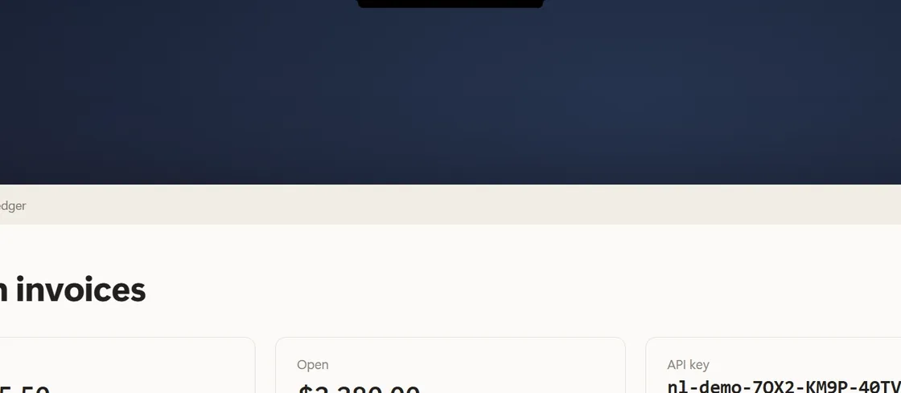
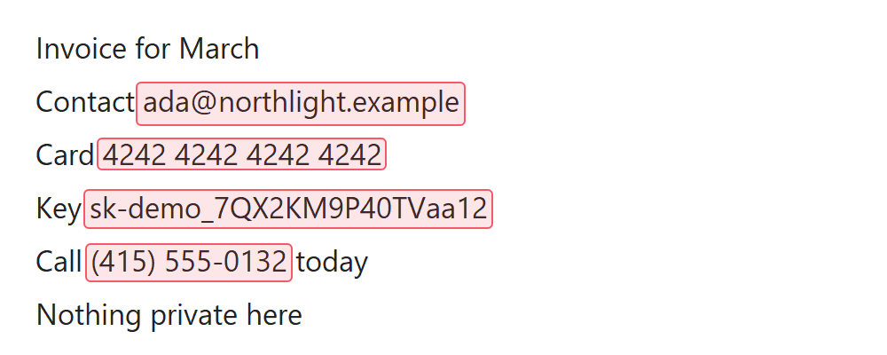
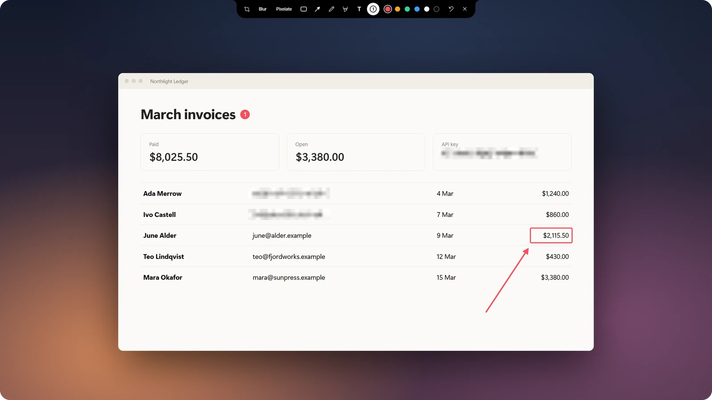

<p align="center">
  
</p>

<p align="center">
  <a href="https://github.com/Nabin-me/ledge-grab/releases/latest">
    
  </a>
  
  
  
  
  <a href="LICENSE">
    
  </a>
</p>

<p align="center">
  <b>Press a key, grab the frame.</b><br>
  Ledge Grab captures your screen in milliseconds, copies it to your clipboard, and rests it on a sleek top-edge ledge until you need it again.
</p>

<p align="center">
  <a href="https://github.com/Nabin-me/ledge-grab/releases/latest"><b>Download for Windows (x64)</b></a>
  &nbsp;&middot;&nbsp;
  <a href="#on-the-ledge">Features</a>
  &nbsp;&middot;&nbsp;
  <a href="#seal-whats-private">Redaction</a>
  &nbsp;&middot;&nbsp;
  <a href="#capture">Shortcuts</a>
  &nbsp;&middot;&nbsp;
  <a href="#build">Build from Source</a>
</p>

<br>

<p align="center">
  
</p>

## Download & Install

Grab the latest Windows x64 build from [**GitHub Releases**](https://github.com/Nabin-me/ledge-grab/releases/latest):

| Package | Best For |
|---|---|
| **`LedgeGrab-Setup-x.y.z-x64.exe`** | Standard Windows installer (no admin required by default, Start Menu shortcut, optional Launch at Login, clean uninstaller) |
| **`LedgeGrab-x.y.z-win-x64-portable.zip`** | Portable zero-install archive — unzip and run anywhere |
| **`LedgeGrab-x.y.z-win-x64.exe`** | Single standalone `~3 MB` executable |

Verify downloads anytime against `SHA256SUMS.txt` attached to every release.

**Updates:** Ledge Grab keeps itself up to date. It checks GitHub Releases shortly after it starts and then every 10 minutes. When a new version is out, it downloads it, verifies it, and installs it the next time nothing is in progress (no recording, Sequential Copy or Scroll to PDF running, shelf closed). The ledge restarts in about a second and says which version you're on. Installed copies run the new installer silently; portable copies replace their own exe. Copies installed for all users (admin installs) don't update themselves. See [docs/auto-update.md](docs/auto-update.md).

**Uninstall:** Open **Windows Settings → Apps → Installed apps → Ledge Grab → Uninstall** (or delete the extracted folder for the portable build). Uninstalling removes the app, shortcuts, and startup entry while keeping your saved screenshots in `Pictures\Ledge Grab`.

## Seal what's private

Blur before you shoot. Drag over anything, or click a word and it is gone. **The pixels are destroyed, not covered.**

Press `B` and Ledge Grab automatically outlines emails, card numbers, phone numbers, and API keys using Windows' built-in offline OCR. Press `B` again to wipe them all. `E` is a smart eraser that seamlessly fills in the background as if nothing was ever there.

<p align="center">
  
</p>

<p align="center">
  
</p>

## On the ledge

| Action | What it does |
|---|---|
| **Hover the ledge** | Pause over the top-edge badge to peek at your last three shots, or click the badge to open immediately. Click a capture to copy it. |
| **`+`** | Every capture mode at a glance. |
| **`⌄`** | Expand the shelf to browse your capture history. |
| **Folder icon** | Open your on-disk capture folder in Explorer. A tiny dot means save-only is on. |
| **`⚙`** | Open Settings directly from the ledge (hotkeys, folder, retention, copied images, save-only, launch at login, quit). |
| **Drag a tile out** | Drops the actual file directly into Slack, Discord, browsers, or any app. |
| **Drop a tile on another** | Stacks related shots together. |
| **Tick tiles, then `→`** | Merge into a lossless PDF, set on a matched backdrop, float above windows, Sequential Copy, stack, or convert a clip to GIF. |
| **All · Clips · App folders · Hidden** | Browse visible captures, clips, by app, or hidden screenshots. Click a folder icon to browse that app; Back or `Esc` returns to folders. |
| **Hide / Show** | Select a screenshot in the shelf and use Hide. In Hidden, select a screenshot and use Show to restore its normal visibility. Neither action moves or deletes a file. |
| **Ledge shortcuts** | While the ledge is open: `Ctrl`+`A` select all, `Shift`+Click range select, `Ctrl`+`C` copy selected, `Del` delete selected, `P` pin/unpin, `Ctrl`+`D` deselect, `Ctrl`+`,` settings, `Esc` back/close. |

Shots roll off the ledge after seven days unless pinned. The files stay in your save folder. New captures are saved by local calendar day, then source app, for example:

```text
Pictures\Ledge Grab\2026-11-25\Notepad\2026-11-25 14.30.52.017 1.png
```

Existing files stay in their original locations. In Settings, **Save screenshots without preview** keeps new screenshots off the peek and skips the thumbnail pop-up while keeping the normal save and copy behavior. Use **Hidden** to find or restore them before they age out of history, or open the save folder at any time. This switch does not hide older visible screenshots retroactively or alter video recordings.

New shortcuts are active only while the ledge is open and the pointer is over it:

| Shortcut | Action |
|---|---|
| `H` | Hide selected or hovered screenshots; show them again when viewing Hidden |
| `Ctrl`+`H` | Open Hidden |
| `Ctrl`+`Shift`+`H` | Toggle save-only for future screenshots |
| `Ctrl`+`O` | Open the capture folder in Explorer |
| `Ctrl`+`1` / `2` / `3` | Open All / Clips / App folders |

The shelf's **App folders** view collects each app's visible captures across dates. The shelf stays open while you use it and briefly after the pointer leaves, so a quick slip off an edge won't close it.

- **Float** pins any capture above all windows — drag to move, scroll to resize, `Ctrl` + scroll to fade opacity, right-click to close.
- **Sequential Copy** puts your selected screenshots on the clipboard one at a time, in shelf order. Each `Ctrl` + `V` pastes the next one, even when pressed quickly. The ledge shows a small preview of the image on the clipboard and "Next 1 of 3". If a paste isn't picked up, it stops and offers **Next** instead of skipping. Copying something else ends the queue. The collapsed ledge shows a dot for each of your newest visible screenshots (up to five, then +). Brighter dots are more recent.
- **Copied images** optionally keeps images copied from other apps right on the ledge (copied text is never stored). Anything marked private by other apps is ignored, and you can toggle it anytime in Settings.

## Capture

| Mode | Shortcut / Trigger |
|---|---|
| **Region** | `Ctrl` + `Shift` + `S` |
| **Screen** | `PrtSc` |
| **Window** | `Alt` + `PrtSc` |
| **Clip (MP4, 30 fps)** | `Shift` + `PrtSc` to start, again to stop |
| **Float** | From the ledge |
| **All · Last · Scroll · Delay · Interval** | From the ledge |
| **Text (Offline OCR)** | Reads words straight to your clipboard |
| **Color** | Picks any pixel as `#RRGGBB` hex |

While the screen is frozen:

| Key | Tool | Key | Tool | Key | Tool |
|---|---|---|---|---|---|
| `R` | Region | `B` | Blur (+ auto-detect secrets) | `P` | Pixelate |
| `E` | Smart Erase | `X` | Box | `A` | Arrow |
| `D` | Pen | `H` | Highlight | `T` | Text |
| `N` | Numbered Steps | | | | |

Scroll for stroke thickness · `Ctrl` + `Z` or right-click to undo · `Esc` to cancel.

## Performance

Measured on an RTX 3070 laptop driving 2560 × 1440 and 1920 × 1080 monitors:

| Metric | Measured |
|---|---|
| Hotkey to frozen screen | **30–65 ms** (up to 100 ms under heavy load) |
| Region to clipboard | **4–9 ms** |
| Full screen to clipboard | **13–22 ms** |
| Idle CPU | **0–0.3%** of one core |
| Fresh start memory | **~57 MB** |
| Memory after captures | **70–110 MB** |
| Recording 780 × 480 clip | **10%** of one core |
| Recording 2560 × 1440 clip | **43%** of one core |

## Build

Requires Rust (2024 edition, tested on 1.98+) and the Windows 10/11 SDK:

```powershell
cargo build --release
```

The output is a single ~3 MB native executable at `target\release\ledge-grab.exe`.

To build the Windows Setup installer (`Inno Setup 6`), portable ZIP, and checksums locally:

```powershell
.\packaging\build-release.ps1
```

<details>
<summary><b>Architecture & how it works</b></summary>
<br>

| Module | Responsibility |
|---|---|
| `src/capture.rs` | Freezes the screen using DXGI Desktop Duplication on the active GPU, falling back to GDI for cross-GPU monitors. |
| `src/overlay.rs` | Frozen-screen canvas: annotation tools, pixel loupe, toolbar, and launch animation up to the ledge. |
| `src/redact.rs` | Irreversible jittered-block blur/pixelation and background-aware smart eraser. |
| `src/secrets.rs` | Pattern & checksum detectors for emails, cards (Luhn), IBANs, phone numbers, JWTs, and API keys. |
| `src/rec.rs` | Region screen recording via `Windows.Graphics.Capture` → MediaFoundation H.264 MP4, plus MP4 → GIF conversion. |
| `src/float.rs` | Always-on-top floating capture windows with wheel zoom and opacity control. |
| `src/pretty.rs` | Soft gradient backdrops derived automatically from each screenshot's own palette. |
| `src/notch.rs` | Top-edge ledge UI: click-through DirectComposition render window paired with an invisible hover sensor window. |
| `src/gfx.rs` | Direct2D + DirectWrite + DirectComposition per-pixel alpha compositor synced to display refresh. |
| `src/store.rs` | Plain PNG files on disk indexed by bundled SQLite (`rusqlite`). |
| `src/clip.rs` | Lazy-rendered clipboard formats, clipboard watcher, Recycle Bin, and native OLE drag-out. |
| `src/scroll.rs` | Automated wheel scrolling, row-profile alignment, and seamless vertical stitching. |
| `src/pdf.rs` | Zero-recompression PNG-to-PDF merger using `pdf-writer`. |
| `src/ocr.rs` | Offline word-level text recognition via `Windows.Media.Ocr`. Nothing ever leaves your machine. |

`cargo test` runs unit tests covering scrolling stitch alignment, irreversible redaction, secret detection, clip fitting, and lossless PDF merging. `tests/drive.py` drives an isolated `LEDGE_GRAB_TEST` instance via posted messages.

</details>

## Privacy & Verification

- **No telemetry:** Ledge Grab's only network request is the update check, which downloads a small signed file from GitHub Releases. GitHub sees your IP address and the Ledge Grab version, nothing else. There are no analytics, crash uploaders, or closed-source components. Every screenshot, clip, OCR scan, and redaction stays on your machine, and copied text is never recorded. To turn the update check off, set the environment variable `LEDGE_GRAB_NO_AUTO_UPDATE=1`.
- **Signed updates:** Each release's update manifest is signed with an ed25519 key held only by the release pipeline. The app refuses an update unless the signature matches the public key built into it, the version is newer, and the file's size and SHA-256 match.
- **Transparent builds:** Licensed under the [MIT License](LICENSE). Official releases are compiled directly from this public repository via GitHub Actions ([`.github/workflows/release.yml`](.github/workflows/release.yml)) and ship with `SHA256SUMS.txt` checksums.
- **Note on Windows SmartScreen:** Because builds are currently unsigned, Windows SmartScreen may show a warning on first run — click **More info → Run anyway**, or build directly from source with `cargo build --release`.

<br>

<p align="center">
  <picture>
    <source media="(prefers-color-scheme: dark)" srcset="assets/brand/mark-light.svg">
    
  </picture>
</p>
