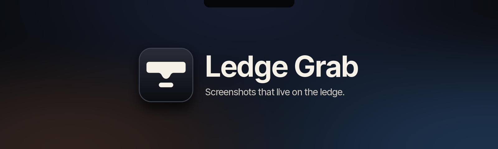
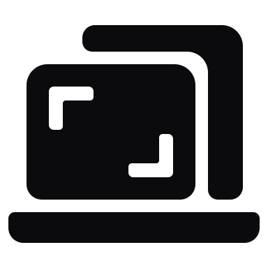

<p align="center">
  
</p>

<p align="center">
  
  
  
  
</p>

<br>

Press a key, leave a mark. Signet takes the shot, puts it on your clipboard, and keeps it at the top of your screen until you need it again.

<p align="center">
  
</p>

## Seal what's private

Blur before you shoot. Drag over anything, or click a word and it is gone. The pixels are destroyed, not covered.

Press `B` and Signet outlines emails, card numbers, phone numbers and API keys. Press it again to hide them all. `E` is an eraser that fills in the background as if nothing was there.

<p align="center">
  
</p>

<p align="center">
  
</p>

## On the notch

|   |   |
|---|---|
| **Hover** | Your last three shots. Click one to copy it. |
| **`+`** | Every way to capture. |
| **`⌄`** | Everything you took this week. |
| **Drag a tile out** | Drops the file into any app. |
| **Drop a tile on another** | Stacks them. |
| **Tick some, then `→`** | Merge as PDF, set on a background, float, queue, stack, or turn a clip into a GIF. |
| **All, Clips, Text, Apps** | Filters. Apps gathers shots by where they came from. |
| **Right-click** | Modes, settings, quit. |

Shots leave the notch after seven days unless pinned. The files stay in your folder, named after what they show.

**Float** keeps a shot above everything. Drag to move, scroll to resize, `Ctrl` scroll to fade, right-click to close.

**Queue** pastes your picks in order, one for each `Ctrl` `V`.

**Clipboard history** keeps text and pictures copied in other apps, on this computer only, as plain text in the index. Anything an app marks private, as password managers do, is left alone. There is a switch in settings.

## Capture

| | |
|---|---|
| **Region** | `Ctrl` `Shift` `S` |
| **Screen** | `PrtSc` |
| **Window** | `Alt` `PrtSc` |
| **Clip** | `Shift` `PrtSc` to start, again to stop. MP4, 30 fps, no sound. |
| **Float** | from the notch |
| **All, Last, Scroll, Delay, Interval** | from the notch |
| **Text** | reads the words straight to your clipboard |
| **Color** | picks a pixel as hex |

While the screen is frozen:

| Key | Tool | Key | Tool | Key | Tool |
|---|---|---|---|---|---|
| `R` | Region | `B` | Blur | `P` | Pixelate |
| `E` | Erase | `X` | Box | `A` | Arrow |
| `D` | Pen | `H` | Highlight | `T` | Text |
| `N` | Steps | | | | |

Scroll for thickness. `Ctrl` `Z` or right-click to undo. `Esc` to leave.

## Fast

Measured on an RTX 3070 laptop driving 2560 × 1440 and 1920 × 1080.

| | |
|---|---|
| Hotkey to frozen screen | 30–65 ms, up to 100 ms on a busy machine |
| Region to clipboard | 4–9 ms |
| Full screen to clipboard | 13–22 ms |
| Idle CPU | 0–0.3% of one core |
| Memory, fresh start | about 57 MB |
| Memory, after captures | 70–110 MB |
| Recording a 780 × 480 clip | 10% of one core |
| Recording 2560 × 1440 | 43% of one core |

## Build

```powershell
cargo build --release
```

Built with Rust 1.98 and the Windows SDK. The result is one file, `target\release\signet.exe`.

<details>
<summary><b>How it works</b></summary>
<br>

| File | Job |
|---|---|
| `capture.rs` | Freezes the screen. Desktop Duplication on the GPU already in use, GDI for monitors on another one. |
| `overlay.rs` | The frozen screen: tools, loupe, toolbar, the flight to the notch. |
| `redact.rs` | Blur and pixelate that cannot be undone from the saved file, and the eraser. |
| `secrets.rs` | Spots emails, cards, phones and keys. |
| `rec.rs` | Clips. Windows.Graphics.Capture into H.264, and MP4 to GIF. |
| `float.rs` | Shots held above everything. |
| `pretty.rs` | Backgrounds, from the shot's own colors. |
| `notch.rs` | The notch. One click-through window draws, one invisible window feels the mouse. |
| `gfx.rs` | Direct2D and DirectComposition, per-pixel alpha, synced to the display. |
| `store.rs` | Shots as plain PNG files, with a SQLite index beside them. |
| `clip.rs` | Clipboard, its history, and drag-out. |
| `scroll.rs` | Scrolls, grabs, and stitches. |
| `pdf.rs` | Puts PNG data into a PDF without encoding it again. |
| `ocr.rs` | Windows' own text recognition. Nothing leaves the machine. |

`cargo test` covers stitching, redaction, secrets, clips and the PDF writer. `tests/drive.py` drives a separate copy of the app with posted messages.

</details>

<br>

<p align="center">
  <picture>
    <source media="(prefers-color-scheme: dark)" srcset="assets/brand/mark-light.svg">
    
  </picture>
</p>
